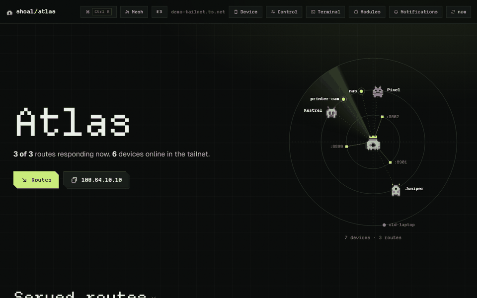
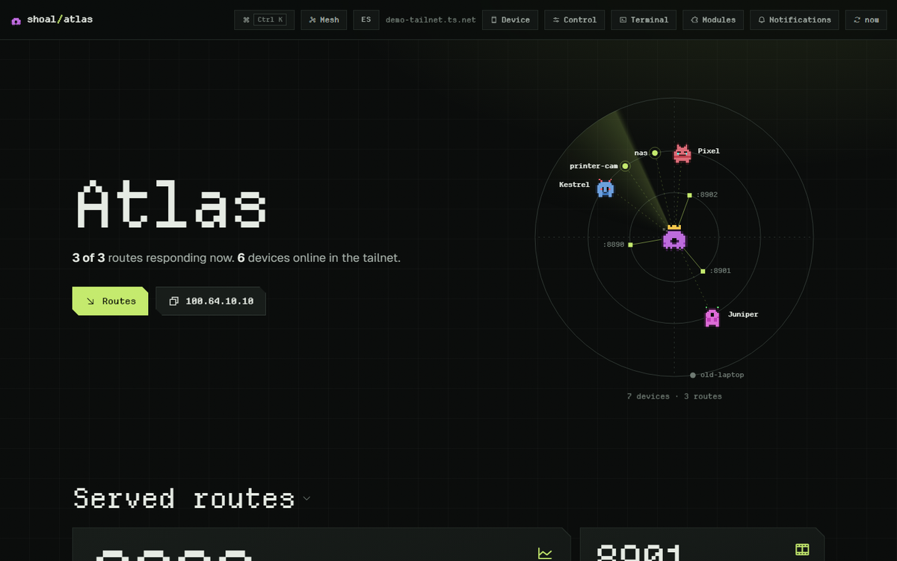
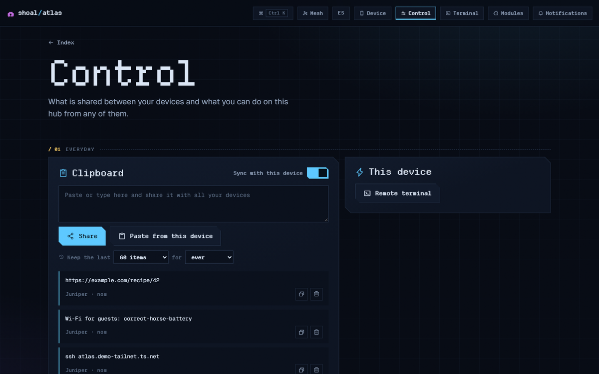
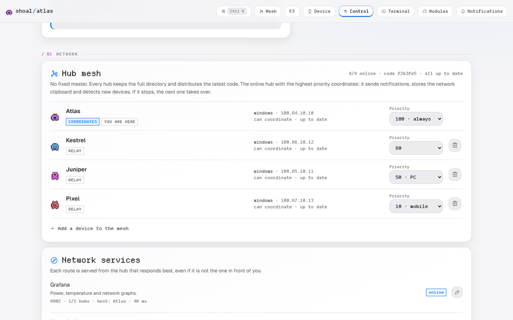
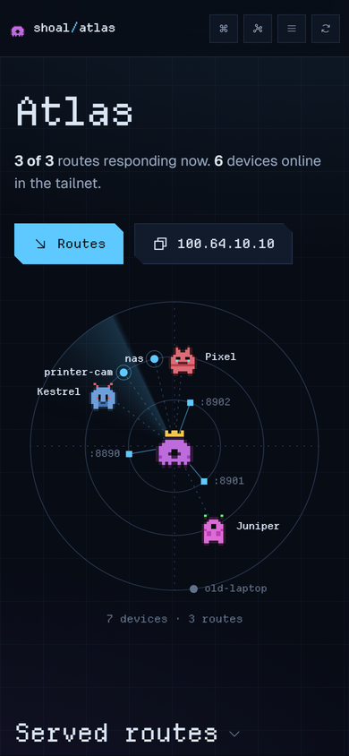

# Shoal

[English](README.md) · Español · [](https://github.com/alfonsoGarnett/shoal/actions/workflows/ci.yml)

Una pequeña aplicación web que corre en cada equipo de tu red de Tailscale y los conecta entre sí:
una página por equipo con sus servicios, un portapapeles compartido, archivos, notificaciones y una
terminal en el navegador hacia cualquiera de ellos. No hay servidor central: cada equipo corre su
propia copia (un *hub*) y los hubs se mantienen al día entre ellos.

*Shoal* significa cardumen (un banco de peces que se mueve junto sin líder). De ahí viene el nombre.



> **Alpha.** Lo uso a diario en una PC con Windows, un servidor con Arch y un teléfono Android,
> pero todavía falta probarlo en más entornos. Lee [SECURITY.md](docs/SECURITY.md) antes de exponer
> cualquier servicio a Internet. Proyecto independiente, no afiliado a Tailscale Inc.

## Qué incluye

- **Una página por equipo** con los servicios que corre (de `tailscale serve`, Docker o tu propia
  lista), si están respondiendo, y botones para iniciarlos, detenerlos y ver sus logs.
- **Un mapa en vivo de tus equipos.** Cada hub tiene una mascota pixelada generada a partir de su
  llave pública y puedes ver cómo se sincronizan en tiempo real.
- **Portapapeles compartido** entre todos tus equipos, con historial.
- **Archivos y Taildrop**: envía o descarga archivos entre cualquiera de tus equipos.
- **Notificaciones** en el teléfono y el escritorio (Web Push) cuando un servicio cae o vuelve.
- **Terminal en el navegador** hacia cualquier equipo, desde cualquier equipo. Viene apagada hasta
  que decidas activarla.
- **Enlaces públicos** con Tailscale Funnel para compartir temporalmente un servicio con alguien
  externo, con caducidad y contraseña opcional.
- **Actualizaciones firmadas que se propagan solas**: actualizas tu primer hub y los demás descargan
  la nueva versión de ahí, firmada con tu propia llave, con vuelta atrás automática si algo falla al
  arrancar.
- **Módulos opcionales**: incluye un panel de OctoPrint para impresoras 3D y un asistente de IA de
  solo lectura que analiza el estado de tu red.

Funciona en Windows, Linux, macOS, Raspberry Pi y Android (con Termux). Cada equipo muestra
únicamente las funciones que soporta.

| | |
|---|---|
|  |  |
|  |  |

## ¿En qué se diferencia de...?

- **Headscale.** Headscale reemplaza el servidor de coordinación de Tailscale. Shoal no toca esa
  capa: corre encima de una tailnet que ya funciona y es lo que usas a diario en tus equipos. (Está
  hecho y probado con Tailscale; con Headscale debería funcionar, pero no se ha probado.)
- **Homepage, Homarr, Dashy.** Son páginas de enlaces y widgets servidas desde una máquina. Shoal
  corre en cada máquina, sin servidor central, y hace cosas en ellas: archivos, portapapeles,
  terminales, servicios, enlaces públicos.
- **Cockpit.** Cockpit administra una máquina Linux a la vez. Shoal cubre todos tus equipos a la
  vez, incluidos Windows y Android, y usa tu identidad de Tailscale en vez de otro inicio de sesión.
- **Beszel, Uptime Kuma.** Herramientas de monitoreo con un servidor central. Shoal tiene un
  historial sencillo de conexión y latencia, pero monitorear no es su función principal, y no hay
  servidor central.

## Antes de empezar

- **Tailscale** instalado y con sesión iniciada en cada equipo.
- **Python 3.9 o más nuevo.** El núcleo no necesita nada más; los instaladores añaden dos paquetes
  opcionales (`cryptography` para firmas rápidas, `pywebpush` para los avisos).
- Para direcciones `https://` y enlaces públicos: **MagicDNS** y **certificados HTTPS** activados en
  la consola de Tailscale (página DNS). Sin eso los hubs funcionan igual en
  `http://<equipo>:8790/hub/`.
- **Git** en el primer equipo, para clonar el repositorio y recibir actualizaciones.

## Instalación

### 1. Tu primer hub

Elige el equipo desde el que vas a actualizar Shoal: una PC o un servidor que esté encendido casi
siempre. Clona el repositorio ahí y corre el instalador desde el clon.

Linux, macOS, Raspberry Pi:

```sh
git clone https://github.com/alfonsoGarnett/shoal.git
cd shoal
sh site/install.sh
```

Windows (PowerShell, sin permisos de administrador):

```powershell
git clone https://github.com/alfonsoGarnett/shoal.git
cd shoal
powershell -ExecutionPolicy Bypass -File site\install-windows.ps1
```

El instalador:

1. instala los paquetes opcionales de Python (en un venv aparte en Linux y macOS);
2. publica el hub en tu tailnet con `tailscale serve`, para que tenga una dirección `https://`;
3. crea la **llave de firma** de las actualizaciones de tu red y te dice dónde quedó;
4. deja el hub arrancando con el equipo (systemd, launchd o una tarea programada de Windows).

**Respalda el archivo de la llave que te indica** (`release_key.json`). Es lo que permite a este hub
publicar actualizaciones para tus otros equipos. Guárdalo en algún lugar fuera de línea.

Luego abre `https://<equipo>.<tu-tailnet>.ts.net/hub/` desde cualquier equipo de tu tailnet.

### 2. Los demás equipos

En el primer hub, abre **Control › Red › Añadir un equipo a la red**. Ahí hay un comando de una línea para
Windows, para Linux/macOS/Raspberry Pi y para Android. Córrelo en el equipo nuevo: descarga Shoal de
tu primer hub (no de Internet), se une a la red y arranca con el equipo. Un minuto después el hub
nuevo aparece en el mapa de todos los demás.

El comando se ve así:

```sh
curl -fsSL https://<primer-hub>.<tu-tailnet>.ts.net/hub/install.sh | sh          # Linux, macOS, Pi
```

```powershell
irm https://<primer-hub>.<tu-tailnet>.ts.net/hub/install.ps1 | iex                # Windows
```

En **Android**, instala primero [Termux](https://f-droid.org/packages/com.termux/),
[Termux:API](https://f-droid.org/packages/com.termux.api/) y
[Termux:Boot](https://f-droid.org/packages/com.termux.boot/) desde F-Droid, abre Termux:Boot una
vez y pega en Termux el comando de Android que te da Control. Los teléfonos no tienen
`tailscale serve`, así que el hub queda en `http://<teléfono>:8790/hub/`.

Si un equipo debe coordinar la red (un servidor o una Raspberry Pi siempre encendidos), dale más
prioridad: `curl -fsSL …/install.sh | HUB_PRIORITY=100 sh`, o cámbiala luego en Control › Red.

### 3. Actualizar

Solo en tu primer hub:

```sh
cd shoal
git pull
python -m core --apply-update     # opcional: si no, se aplica sola tras dos minutos sin cambios
```

El primer hub revisa el código nuevo, lo firma con tu llave, lo corre 45 segundos para confirmar que
arranca, y luego todos los demás hubs lo descargan de ahí. Si no arranca, vuelve solo a la versión
anterior y ningún otro hub la instala.

Tus hubs nunca descargan código de GitHub por su cuenta. Tú decides cuándo hacer `pull`, y puedes
leer antes qué cambió. Más en [docs/RELEASES.md](docs/RELEASES.md), incluido cómo pausar las
actualizaciones en un equipo o volver a la versión anterior.

### Desinstalar

En el equipo, corre el mismo comando con `--uninstall` (conserva los datos del hub) o
`--uninstall --purge` (los borra):

```sh
curl -fsSL https://<primer-hub>.<tu-tailnet>.ts.net/hub/install.sh | sh -s -- --uninstall
sh site/install.sh --uninstall                     # en el primer hub; tu clon nunca se borra
```

```powershell
& ([scriptblock]::Create((irm https://<primer-hub>.<tu-tailnet>.ts.net/hub/install.ps1))) -Uninstall
powershell -ExecutionPolicy Bypass -File site\install-windows.ps1 -Uninstall   # en el primer hub
```

Después quítalo de la red en Control › Red.

## Pruébalo sin instalar

```sh
python tools/demo.py
```

Levanta cuatro hubs de prueba en `http://127.0.0.1:8890/hub/` a `8893`, con equipos y servicios de
ejemplo. No toca Tailscale, tus archivos ni tu portapapeles. Con Ctrl+C se detiene.

## Cómo funciona

Cada hub guarda el directorio completo de la red y cada minuto se sincroniza (gossip) con algunos de
sus pares: quién está en línea, qué servicios publica, el portapapeles compartido y los ajustes.
Cada campo lleva un reloj lógico (HLC), de modo que los cambios hechos en distintos equipos se
fusionan sin pisarse. Para las pocas tareas que requieren un único encargado (enviar notificaciones
Web Push o mantener el portapapeles de red), el hub en línea con mayor prioridad asume ese rol y el
siguiente toma el relevo si se desconecta.

Las peticiones entre hubs van firmadas con la llave Ed25519 de cada nodo. Las actualizaciones de
código van firmadas con tu llave de autor y se verifican antes de aplicarse.

El núcleo es un único proceso de Python sin dependencias obligatorias. La interfaz está hecha en
HTML, CSS y JavaScript puro, servida por el mismo proceso. En
[docs/ARCHITECTURE.md](docs/ARCHITECTURE.md) hay diagramas detallados (en inglés).

## Seguridad, en corto

- Solo entras tú. Con `tailscale serve`, Tailscale identifica quién hace la petición y solo se
  acepta al propietario de la tailnet. Las conexiones directas solo se aceptan desde tus propios
  equipos registrados.
- Los enlaces públicos (Funnel) solo abren la ruta compartida; cualquier otra ruta responde 404 a
  Internet.
- La terminal viene desactivada por defecto. Activarla puede requerir aprobación desde un segundo
  equipo (quórum).
- Las actualizaciones van firmadas con tu llave. Un hub jamás acepta código firmado por terceros, ni
  siquiera por este repositorio.

El modelo de amenazas completo y cómo reportar una vulnerabilidad están en
[docs/SECURITY.md](docs/SECURITY.md).

## Módulos

Un módulo es una sola carpeta. Si la colocas en `core/modules/` dentro de tu primer hub, se firma y
se distribuye al resto de tus equipos con la siguiente actualización; queda desactivado hasta que lo
habilites en **Control › Módulos**. Como los módulos corren en el mismo proceso del hub, instala
únicamente código que hayas revisado. Shoal incluye dos:

- **OctoPrint**: estado de la impresora, curva de temperaturas, cámara y acciones seguras (pausar,
  cancelar). Por seguridad, calentar fusor o cama no está expuesto en el hub.
- **Arquitecto**: un asistente de solo lectura que puedes conectar a cualquier endpoint compatible
  con OpenAI (o a un modelo local como Ollama). Recibe un resumen limpio de tu red para responder
  preguntas o diagnosticar fallos, sin permisos para ejecutar acciones. Más detalles en
  [docs/AI.md](docs/AI.md).

Cómo crear o instalar módulos (incluye una plantilla lista para copiar en `docs/examples/hello/`):
[docs/MODULES.md](docs/MODULES.md).

## Configuración

Cada hub guarda su estado en `~/.hub-core` (Linux, macOS, Android) o `%LOCALAPPDATA%\Shoal\data`
(Windows); puedes cambiar la ruta con `--home`. Casi todo se configura desde la interfaz web.
Variables de entorno opcionales:

| Variable | Por defecto | Qué hace |
|---|---|---|
| `HUB_PORT` / `HUB_BIND` | `8790` / todas las interfaces | puerto e interfaz donde escucha el hub |
| `HUB_NAME` | nombre del equipo | nombre visible del hub |
| `HUB_PRIORITY` | según plataforma | prioridad para coordinar: `100` servidor/Pi, `50` PC, `10` teléfono, `0` nunca |
| `HUB_MESH_EVERY` | `60` s | intervalo de sincronización (gossip) entre hubs |
| `HUB_MESH_ALIVE` | `180` s | segundos sin respuesta antes de marcar un hub como desconectado |
| `HUB_UPDATE_GRACE` | `900` s | espera máxima para confirmar que una versión nueva es estable |
| `HUB_BLOB_RF` | `2` | número de copias que se conservan de cada archivo compartido |
| `HUB_AUTO_DEPS` / `--auto-deps` | activado por el instalador | instala `cryptography` en segundo plano si no está presente |
| `HUB_NO_RESTART` | sin definir | desactiva reinicios y rollbacks automáticos (usado en pruebas) |

Archivos de ejemplo: [`config.example.json`](config.example.json),
[`services.example.json`](services.example.json), [`.env.example`](.env.example). Guía de
despliegue: [docs/DEPLOYMENT.md](docs/DEPLOYMENT.md).

## Pruebas

```sh
python tests/test_unit.py      # firmas, CRDTs, quórum, actualizaciones, módulos y seguridad
python tests/test_mesh.py      # malla de dos hubs aislados en 127.0.0.1
python tests/test_pty.py       # terminales interactivas: PTY en Linux/macOS, ConPTY en Windows
```

Todas las pruebas usan directorios temporales y puertos propios sin tocar tu instalación. CI las
ejecuta en Linux, Windows y macOS con Python 3.9, 3.12 y 3.13.

## Límites conocidos

- Se usa a diario en Windows, Arch Linux y Android. El instalador de Linux está probado en Ubuntu;
  Raspberry Pi y macOS todavía no se han probado en hardware real. Se agradecen reportes.
- Emparejar dos tailnets distintas está implementado pero no se ha probado entre dos reales.
- El navegador entra por la dirección de un hub. Si ese equipo está apagado, usa la de otro hub.
- La implementación de Ed25519 de respaldo (cuando falta `cryptography`) pasa los vectores de prueba
  del RFC 8032, pero no ha sido auditada.
- No reemplaza la consola de Tailscale, Headscale ni una herramienta completa de administración
  remota.

## Contribuir

Issues y pull requests son bienvenidos: mira [CONTRIBUTING.md](CONTRIBUTING.md). Por favor deja
fuera nombres reales de tu tailnet, llaves y capturas de tu propia red.

## Licencia

MIT, ver [LICENSE](LICENSE). Las fuentes y los iconos tienen sus propias licencias, listadas en
[NOTICE](NOTICE). Tailscale es una marca de Tailscale Inc.; este proyecto no está afiliado a ella ni
cuenta con su respaldo.
