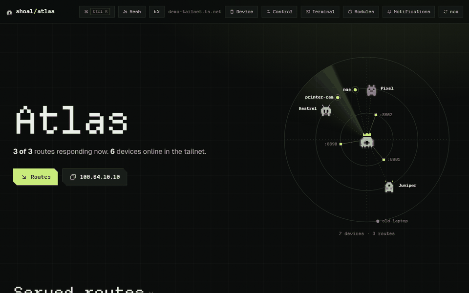
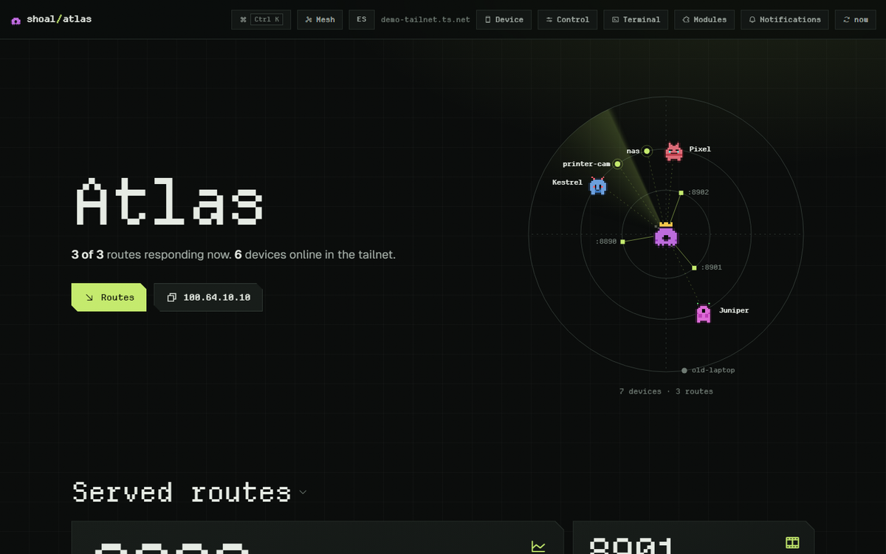
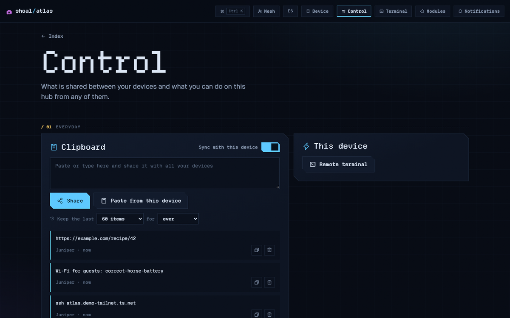
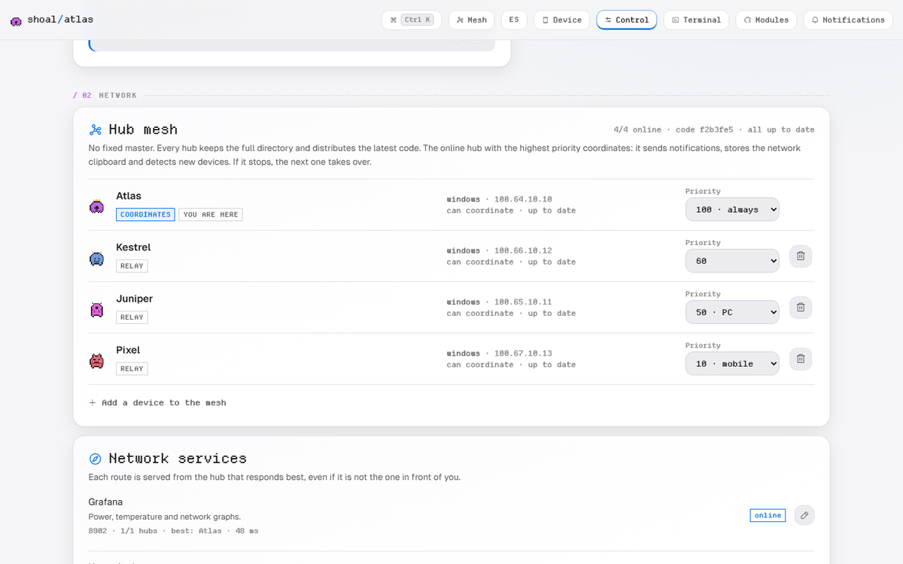
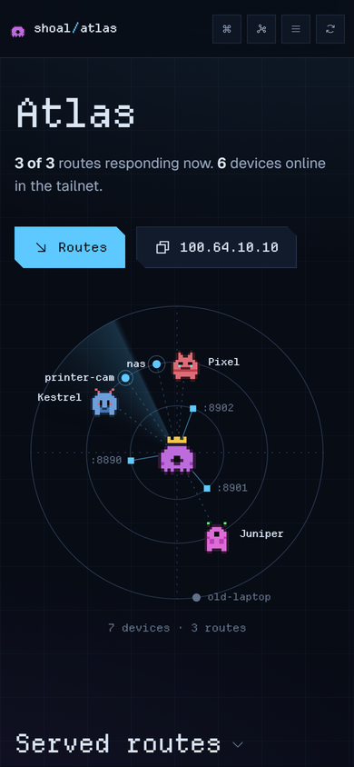

# Shoal

English · [Español](README.es.md)

A small web app that runs on every device in your Tailscale network and ties them together.
One page per device with its services, a shared clipboard, files, notifications, and a browser
terminal into any of them. There is no central server: each device runs its own copy (a _hub_),
and the hubs keep each other up to date.

A shoal is a school of fish moving together with no leader. That's the idea.



> **Alpha.** I run it every day on a Windows PC, an Arch server and an Android phone, but it has
> not been tested on many other setups yet. Read [SECURITY.md](docs/SECURITY.md) before you
> expose anything to the Internet. Not affiliated with Tailscale Inc.

## What you get

- **A page per device** with the services it runs (from `tailscale serve`, Docker or your own
  list), whether they answer, and buttons to start, stop and read their logs.
- **A live map of your devices.** Each hub has a little pixel creature made from its key; you
  watch them talk to each other.
- **A shared clipboard** across all your devices, with history.
- **Files and Taildrop**: send a file to any device from any device.
- **Notifications** to your phone and desktop (Web Push) when something goes down or comes back.
- **A terminal** into any device, from any device, in the browser. Off until you turn it on.
- **Public links** through Tailscale Funnel when you want to show one service to someone outside,
  with an expiry and an optional password.
- **Updates that spread by themselves**: update one hub and the rest follow, signed with your own
  key, with an automatic way back if the new version does not start.
- **Optional modules**: an OctoPrint dashboard for a 3D printer, and a read-only AI assistant
  that explains what your network is doing.

It runs on Windows, Linux, macOS, Raspberry Pi and Android (in Termux). Each device only shows
what it can actually do.

|                                                                             |                                           |
| --------------------------------------------------------------------------- | ----------------------------------------- |
|                                 |   |
|  |  |

## How is this different from...

- **Headscale.** Headscale replaces Tailscale's coordination server. Shoal does not touch that
  layer: it runs on top of a tailnet that already works and is what you use day to day across your
  devices. (It is built and tested against Tailscale itself; Headscale should work but has not
  been tried.)
- **Homepage, Homarr, Dashy.** Those are pages of links and widgets served from one machine. Shoal
  runs on every machine, with no central server, and does things on them: files, the clipboard,
  terminals, services, public links.
- **Cockpit.** Cockpit manages one Linux machine at a time. Shoal covers all your devices at once,
  Windows and Android included, and uses your Tailscale identity instead of separate logins.
- **Beszel, Uptime Kuma.** Monitoring tools with a central server. Shoal has a simple
  online/latency history, but monitoring is not its main job, and there is no central server.

## Before you start

- **Tailscale** installed and signed in on each device.
- **Python 3.9 or newer.** The core needs nothing else; the installers add two optional packages
  (`cryptography` for fast signatures, `pywebpush` for notifications).
- For `https://` addresses and public links: **MagicDNS** and **HTTPS certificates** turned on in
  the Tailscale admin console (DNS page). Without them the hubs still work over
  `http://<device>:8790/hub/`.
- **Git** on the first device, to clone the repository and get updates.

## Install

### 1. Your first hub

Pick the device you will update Shoal from: a PC or a server that is on most of the time. Clone the
repository there and run the installer from the clone.

Linux, macOS, Raspberry Pi:

```sh
git clone https://github.com/alfonsoGarnett/shoal.git
cd shoal
sh site/install.sh
```

Windows (PowerShell, no admin needed):

```powershell
git clone https://github.com/alfonsoGarnett/shoal.git
cd shoal
powershell -ExecutionPolicy Bypass -File site\install-windows.ps1
```

The installer:

1. installs the optional Python packages (in a separate venv on Linux and macOS);
2. publishes the hub on your tailnet with `tailscale serve`, so it gets an `https://` address;
3. creates the **signing key** for your network's updates and tells you where it is;
4. sets the hub to start with the device (systemd, launchd or a Windows scheduled task).

**Back up the signing key file it prints** (`release_key.json`). It is what lets this hub publish
updates to your other devices. Keep it somewhere offline.

Then open `https://<device>.<your-tailnet>.ts.net/hub/` from any device in your tailnet.

### 2. Every other device

On the first hub, open **Control › Network › Add a device to the mesh**. It shows a one-line command for
Windows, for Linux/macOS/Raspberry Pi and for Android. Run it on the new device: it downloads Shoal
from your first hub (not from the Internet), joins the network and starts at boot. A minute later
the new hub shows up on the map of every other hub.

The command looks like this:

```sh
curl -fsSL https://<first-hub>.<your-tailnet>.ts.net/hub/install.sh | sh          # Linux, macOS, Pi
```

```powershell
irm https://<first-hub>.<your-tailnet>.ts.net/hub/install.ps1 | iex                # Windows
```

On **Android**, install [Termux](https://f-droid.org/packages/com.termux/),
[Termux:API](https://f-droid.org/packages/com.termux.api/) and
[Termux:Boot](https://f-droid.org/packages/com.termux.boot/) from F-Droid first, open Termux:Boot
once, and paste the Android command from Control into Termux. Phones have no `tailscale serve`, so
the hub is at `http://<phone>:8790/hub/`.

If a device should coordinate the network (an always-on server or Raspberry Pi), give it a higher
priority: `curl -fsSL …/install.sh | HUB_PRIORITY=100 sh`, or change it later in Control › Network.

### 3. Updating

Only on your first hub:

```sh
cd shoal
git pull
python -m core --apply-update     # optional: otherwise it applies by itself after two quiet minutes
```

The first hub checks the new code, signs it with your key, runs it for 45 seconds to make sure it
starts, and then every other hub downloads it from there. If it does not start, it goes back to
the previous version on its own and no other hub installs it.

Your hubs never download code from GitHub themselves. You decide when to pull, and you can read
what changed first. More in [docs/RELEASES.md](docs/RELEASES.md), including how to pause updates on
one device or go back to the previous version.

### Uninstall

On the device, run the same command with `--uninstall` (keeps the hub's data) or
`--uninstall --purge` (deletes it):

```sh
curl -fsSL https://<first-hub>.<your-tailnet>.ts.net/hub/install.sh | sh -s -- --uninstall
sh site/install.sh --uninstall                     # on the first hub; your clone is never deleted
```

```powershell
& ([scriptblock]::Create((irm https://<first-hub>.<your-tailnet>.ts.net/hub/install.ps1))) -Uninstall
powershell -ExecutionPolicy Bypass -File site\install-windows.ps1 -Uninstall   # on the first hub
```

Then remove it from the network in Control › Network.

## Try it without installing

```sh
python tools/demo.py
```

Starts four test hubs on `http://127.0.0.1:8890/hub/` through `8893`, with sample devices and
services. It does not touch Tailscale, your files or your clipboard. Ctrl+C stops it.

## How it works

Every hub has the full list of hubs and gossips with a few of them every minute: who is online,
what services they run, the shared clipboard, settings. Each piece of data carries a logical clock,
so edits made on different devices merge instead of overwriting each other. A few jobs need one
place (sending notifications, keeping the clipboard), so the online hub with the highest priority
takes them, and the next one takes over if it disappears.

Requests between hubs are signed with each hub's own key. Code updates are signed with your key and
checked before they are applied.

The core is one Python process with no required dependencies. The interface is plain HTML, CSS and
JavaScript, served by the same process. [docs/ARCHITECTURE.md](docs/ARCHITECTURE.md) has diagrams
of all of it.

## Security, in short

- Only you get in. Through `tailscale serve`, Tailscale tells the hub who is asking, and only the
  tailnet owner is accepted. Direct connections are accepted only from your own devices.
- Public links (Funnel) go through a gate on the hub; everything else answers 404 to the Internet.
- The terminal is off by default. Turning it on can require approval from a second device.
- Updates are signed with your key. A hub never accepts code signed by anyone else, including this
  project.

Full threat model and how to report a vulnerability: [docs/SECURITY.md](docs/SECURITY.md).

## Modules

A module is one folder. Put it in `core/modules/` on your first hub and it reaches every hub with the
next update; it stays off until you turn it on in **Control › Modules**. Modules run with the hub's
full rights, so only add ones you have read. Two come with Shoal:

- **OctoPrint**: printer status, temperatures, camera, and safe actions (pause, cancel). Heating
  is deliberately not available from the hub.
- **Architect**: an assistant you connect to any OpenAI-compatible API (or a local model). It
  sees a cleaned-up summary of your network and answers questions about it. It cannot change
  anything. See [docs/AI.md](docs/AI.md).

Installing and writing modules, with a small example to copy: [docs/MODULES.md](docs/MODULES.md).

## Configuration

A hub keeps its data in `~/.hub-core` (Linux, macOS, Android) or `%LOCALAPPDATA%\Shoal\data`
(Windows); `--home` changes it. Most settings live in the interface. Environment variables:

| Variable                        | Default                 | What it does                                                        |
| ------------------------------- | ----------------------- | ------------------------------------------------------------------- |
| `HUB_PORT` / `HUB_BIND`         | `8790` / all interfaces | where the hub listens                                               |
| `HUB_NAME`                      | the device name         | the hub's name                                                      |
| `HUB_PRIORITY`                  | by platform             | who coordinates: `100` server or Pi, `50` PC, `10` phone, `0` never |
| `HUB_MESH_EVERY`                | `60` s                  | how often hubs gossip                                               |
| `HUB_MESH_ALIVE`                | `180` s                 | silence before a hub counts as offline                              |
| `HUB_UPDATE_GRACE`              | `900` s                 | how long hubs wait for a new version to be confirmed healthy        |
| `HUB_BLOB_RF`                   | `2`                     | copies kept of each shared file                                     |
| `HUB_AUTO_DEPS` / `--auto-deps` | set by the installers   | install `cryptography` in the background if it is missing           |
| `HUB_NO_RESTART`                | unset                   | never restart or roll back (tests only)                             |

Examples: [`config.example.json`](config.example.json), [`services.example.json`](services.example.json),
[`.env.example`](.env.example). Deployment details: [docs/DEPLOYMENT.md](docs/DEPLOYMENT.md).

## Tests

```sh
python tests/test_unit.py      # signatures, merges, approvals, releases, modules, hardening
python tests/test_mesh.py      # two real hubs on 127.0.0.1
python tests/test_pty.py       # interactive shells: PTY on Linux/macOS, ConPTY on Windows
```

They use temporary folders and their own ports, never a running hub's. CI runs them on Linux,
Windows and macOS with Python 3.9, 3.12 and 3.13.

## Known limits

- Used day to day on Windows, Arch Linux and Android. The Linux installer is tested on Ubuntu;
  Raspberry Pi and macOS have not been tried on real hardware yet. Reports welcome.
- Pairing two different tailnets is implemented but has not been tried between two real ones.
- The browser enters through one hub's address. If that device is off, use another hub's address.
- The Ed25519 fallback (used when `cryptography` is missing) is checked against the RFC 8032 test
  vectors but has not been audited.
- Not a replacement for Tailscale's admin console, Headscale or a full remote-management tool.

## Contributing

Issues and pull requests are welcome: see [CONTRIBUTING.md](CONTRIBUTING.md). Please leave real
tailnet names, keys and screenshots of your own network out of them.

## License

MIT, see [LICENSE](LICENSE). Fonts and icons are under their own licences, listed in
[NOTICE](NOTICE). Tailscale is a trademark of Tailscale Inc.; this project is not affiliated with
or endorsed by it.
