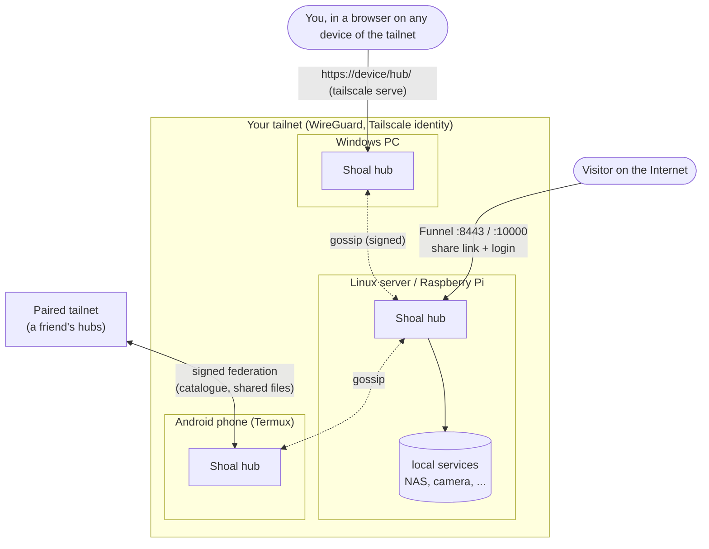
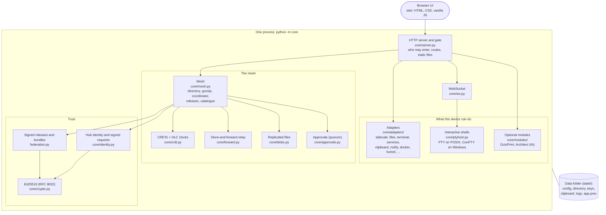
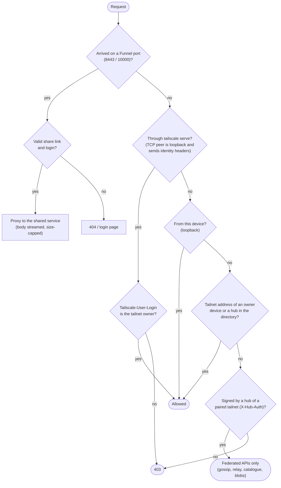
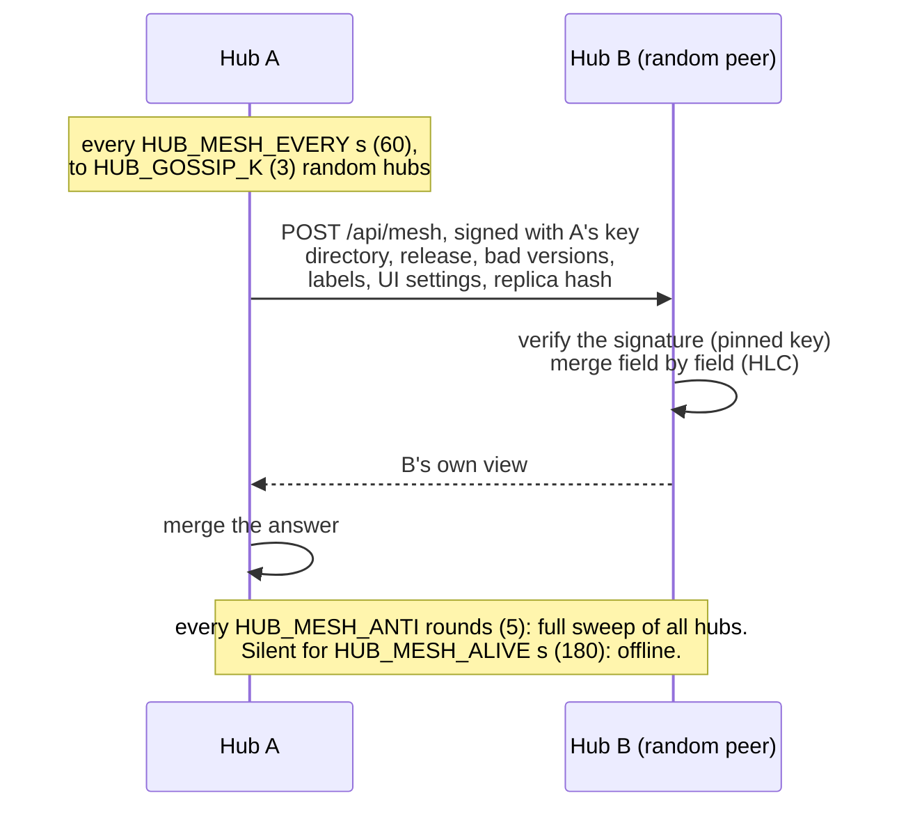
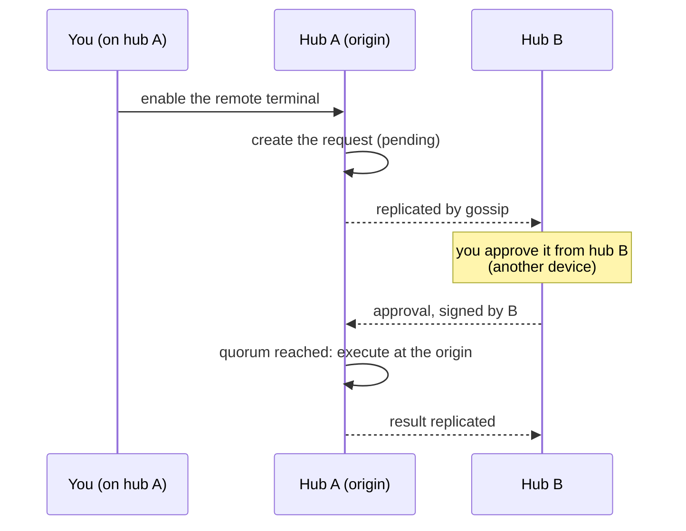
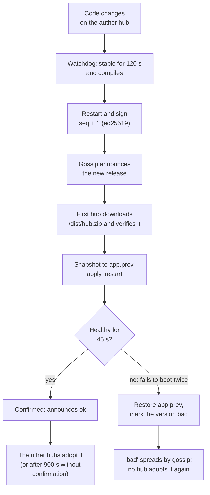
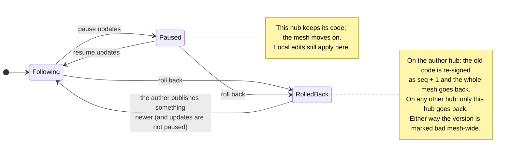
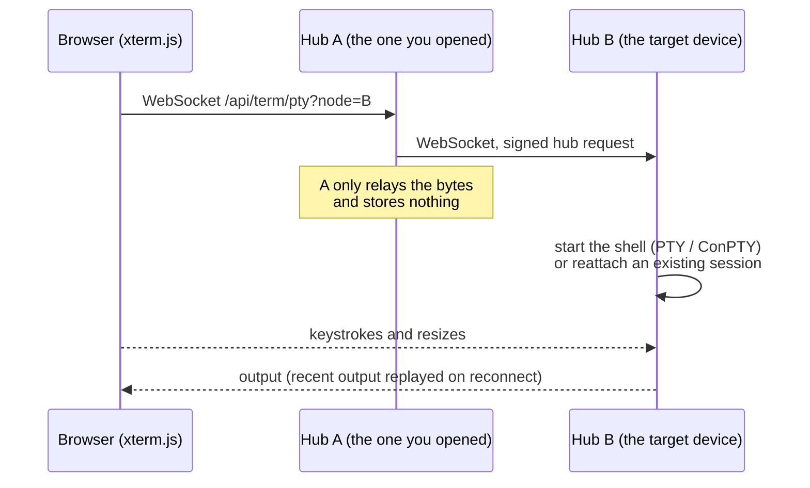

# Architecture

Every device runs the same single Python process, serves the same web UI, and keeps its own data
folder. There is no server in the middle: the hubs are peers, and any of them can answer for the
whole network.

The diagrams below are [Mermaid](https://mermaid.js.org/); GitHub renders them in place.

## The big picture

Every device in the tailnet runs the same hub. You open whichever one is closest; it knows about
all the others because the hubs gossip a shared directory among themselves.



- **Same hub everywhere.** The same `core/` and `site/` run on Windows, Linux, macOS, Raspberry Pi
  and Android/Termux. What differs is what each device *can* do, which the hub detects at start.
- **No fixed master.** Every hub stores the full directory. A *coordinator* is elected for the few
  jobs that need one place (Web Push, the network clipboard); if it disappears another takes over.
- **Tailscale is the front door.** Access comes from Tailscale identity. The hub adds no accounts
  of its own, except the optional login in front of public (Funnel) links.

## Inside one hub



```
core/
  server.py       HTTP server, auth gate, routes, static files
  mesh.py         directory CRDT, gossip, coordinator, releases, catalogue
  identity.py     hub keys and signed hub-to-hub requests
  crypto.py       ed25519 (RFC 8032), native when `cryptography` is installed
  crdt.py         HLC and merge primitives
  approvals.py    quorum requests and execution at the origin
  forward.py      store-and-forward relay
  blobs.py        content-addressed replicated files
  peering.py      signed invitations and allowlists between tailnets
  ptyhost.py      interactive shells (PTY / ConPTY) that survive reconnections
  ws.py           WebSocket server and hub-to-hub WebSocket relay
  deps.py         optional native dependencies (opt-in)
  adapters/       platform capabilities (Tailscale, files, terminal, ...)
  modules/        optional product features (OctoPrint, Architect)
federation.py     code fingerprint, signed releases, bundles, snapshots
site/             vanilla HTML/CSS/JS UI and i18n catalogs
```

## Principles

1. **Same hub everywhere.** One code base, one bundle, every platform.
2. **Only show what works on that device.** Adapters declare what the device can do. The UI hides
   unavailable sections via `api/caps`, so a phone never shows a button only a PC can run.
3. **Local first, delegate when needed.** If a device cannot do something locally, a capable hub
   can do it on its behalf.
4. **No fixed master.** Every hub stores the full directory. The coordinator is an ephemeral role.
5. **Signed code only.** A local edit can run on that hub, but it does not spread until it is part
   of a signed release.
6. **Safe defaults.** Remote terminal, Funnel, and optional modules are off until you enable them.
   Nothing is installed on a device without an explicit opt-in.

## Who gets in

Every request goes through the same gate before any route runs.



- Identity headers (`Tailscale-User-Login`, `X-Forwarded-For`) are believed only when the TCP
  peer is loopback, i.e. `tailscaled` itself. A tailnet client cannot forge them.
- A tailnet address alone proves nothing: `100.64.0.0/10` is also carrier-grade NAT on many ISPs
  and mobile carriers. Before a hub knows any device (first boot without the Tailscale CLI, before
  enrolling) only the device itself gets in.
- "Hub in the directory" means a hub of this tailnet. Hubs of a paired tailnet are in the directory
  too, but they only reach the federated APIs, and what they send speaks only for their own tailnet.
- Browser requests must come from the hub's own origin, port included (CSRF, cross-site WebSocket).

## Mesh and directory

The directory (`directory.json`) is a map of hub records. Every field carries a hybrid logical
clock (HLC), so two hubs editing different fields never overwrite each other, and the newest edit of
the same field wins on every hub.



- Removal is a tombstone (`removed`), not a delete, so a removed hub cannot come back by gossip.
- Hub keys are pinned on first contact (TOFU); a changed key is refused.
- Service labels, the clipboard, Web Push subscriptions and the mesh-wide UI settings (theme,
  mascots, pixel type) are CRDTs too, replicated by the same gossip.
- Enrollment works against any hub and then spreads by gossip.
- Messages to an offline hub wait in a store-and-forward outbox and are delivered when it returns.

## Coordinator

A hub can coordinate only if it has the Tailscale CLI and Web Push. The coordinator is chosen by
priority, then age, then name. It sends notifications, owns the network clipboard, and announces
new devices. Other capable hubs keep a CRDT replica and take over after a partition. Without a
coordinator each hub keeps working; notifications wait in the outbox and are relayed later.

## Quorum

Sensitive actions can require approval from 1 to 3 hubs:

- enabling the remote terminal;
- removing a hub from the mesh;
- shutting down a device.



If fewer hubs are online than the configured quorum, the quorum is lowered automatically. Funnel
is deliberately outside the quorum: stopping public access must be a single, immediate decision.

## Releases

A release is the code fingerprint plus a signature: `RELEASE.json` holds
`{version, stamp, seq, pub, sig}`. Only the hub that holds the author key signs; every other hub
verifies and adopts.



- `version` is a fingerprint over root `*.py`, `README.md`, `site/` and `core/`.
- `seq` is monotonic: a hub never moves to a release with a lower or equal sequence.
- The first author key is pinned (TOFU); after that an unsigned or differently signed release is
  ignored.
- A bundle is verified before it is applied: signature, matching fingerprint, safe paths and
  Python that compiles. A guardian in `core/__main__.py` restores `app.prev` even when the new code
  cannot be imported at all.

### Pause and rollback (per hub)



Hubs on different versions keep working together: what they exchange is versioned (`PROTOCOL`,
today 2) and new fields are additive, so a paused or rolled-back hub still syncs the directory,
the clipboard and the settings. What it misses are the features and fixes of
the newer code. Details and commands: [RELEASES.md](RELEASES.md).

## Remote terminal



Sessions survive a closed tab or a dropped connection for 15 minutes. The terminal is off until
enabled (subject to the quorum), and the start and end of every session are logged with who opened it.

## Public sharing (Funnel)

Funnel publishes up to two services from one hub on the public ports **8443** and **10000**;
port 443 stays the private hub. The hub is the gate:

- a share link `/s/<token>` sets a cookie (`Secure`, `HttpOnly`, `SameSite=Lax`); the token is
  high-entropy and expires;
- an optional login (PBKDF2 password) sits in front, with a per-visitor failure brake;
- everything else answers 404;
- request bodies are streamed to the service and capped; a login form bigger than 4 KB is refused
  unread.

## Modules

Modules are optional product features, not platform adapters. Each one is a folder in
`core/modules/<id>/` (its Python, manifest, strings and panel), found at startup and shipped inside
the signed bundle, so adding a folder on the first hub adds the module to every hub. A module
declares its manifest, configuration schema, routes, panel, events and permissions. See
[MODULES.md](MODULES.md).

The Architect is a module by design: the hub must work without an LLM, without internet, and
without API keys.

## Internationalization

English is the source language and the default. Spanish is a full UI translation. All user-facing
strings live in `site/i18n/{en,es}.json` (and each module's `i18n/`); server errors and logs are
English, and a test keeps them that way. See [I18N.md](I18N.md).

## What this is not

- Not a replacement for the Tailscale control plane or Headscale.
- Not a multi-tenant SaaS.
- Not a general-purpose RMM.
- Not a sandbox for untrusted modules. A module runs with the hub's rights; install only modules you have read.
